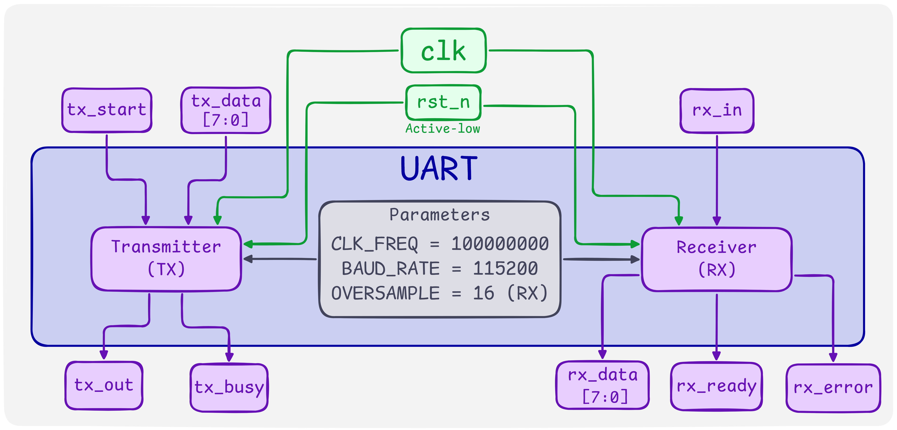
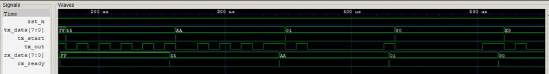

# UART TX/RX with a UVM Testbench

A UART transmitter and receiver in SystemVerilog (8N1, 115200 baud, 100 MHz clock, parameterized), with a 16x-oversampling receiver. It is verified two ways with a UVM environment: in loopback (TX wired to RX), and in a bit-bang mode where the testbench drives the RX line directly to inject framing errors and stress baud-rate tolerance. The environment has a driver, sequencer, two monitors, a scoreboard with a reference model, and hand-coded coverage. The interface also carries SystemVerilog Assertions (SVA) that check the TX waveform cycle by cycle.

The Questa starter edition I use doesn't support `randomize()` or `covergroup`, so stimulus comes from `$urandom_range` and coverage is tracked with plain counters and bins in a `uvm_subscriber`. It's more manual than the standard flow, but it made me decide what "covered" means for a UART data path instead of letting a covergroup decide.

## Design

**TX.** A four-state FSM (IDLE, START, DATA, STOP). `tx_start` latches `tx_data`, and the frame goes out LSB first: one start bit, eight data bits, one stop bit, each lasting `CLK_FREQ / BAUD_RATE` clocks. `tx_busy` is decoded from the state, so it rises one clock after `tx_start`. Measured in simulation, it stays high for 8681 clocks per frame, one clock longer than the 10 bit times (8680) of the frame itself. The SVAs encode this explicitly (see [Assertions](#assertions-sva)).

**RX.** The input goes through a 2-FF synchronizer. When the line falls, an oversample counter starts and ticks every `CLK_FREQ / (BAUD_RATE x OVERSAMPLE)` clocks (54 with the defaults), 16 ticks per bit. The start bit is re-checked at tick 7 (mid-bit) to reject glitches. On entering DATA the tick count is cleared, so each data bit is sampled 16 ticks later, at its centre, and every following bit stays 16 ticks apart. The stop bit is checked at its centre: high produces a one-cycle `rx_ready` and updates `rx_data`, low produces a one-cycle `rx_error` and leaves `rx_data` untouched. Because the RX reports mid-stop-bit, `rx_ready` arrives about half a bit before the TX's `tx_busy` falls.

**Baud error.** 100 MHz / (115200 x 16) = 54.25, truncated to 54. The RX therefore times a bit as 864 clocks while the TX sends it in 868, about 0.46% off. That is a drift of about 4 clocks per bit, which accumulates over the frame to roughly 40 clocks by the stop bit. The margin is half a bit, about 430 clocks, so this is harmless, and I kept the integer divider rather than adding a fractional one, avoiding the complexity that comes with it.

## Verification modes

The interface has two signals, `rx_sel` and `rx_drv`, that choose where the RX input comes from.

**Loopback (default, `rx_sel = 0`).** The RX input is the TX output. The driver pulses `tx_start` and the TX serializes the byte into the RX. This checks the TX and RX against each other, but it can only produce frames the TX is willing to send: always valid, always at exactly the nominal baud rate.

**Bit-bang (`rx_sel = 1`).** The RX input comes from `rx_drv`, which the driver controls directly through `drv_cb`. The driver builds each frame itself, one bit at a time, and holds each bit for a chosen number of clocks. This reaches waveforms the TX would never produce, which is what the next two features use.

**Error injection (`inject_error`).** When the flag is set on an item, the driver forces the stop bit low. The RX should answer with a one-cycle `rx_error`, no `rx_ready`, and `rx_data` left unchanged. This is the only way to reach the error path of the RX, since a loopback TX never sends a bad stop bit.

**Bit scale (`bit_scale`).** A multiplier on the bit period the driver uses in bit-bang mode, so the RX sees a transmitter that is slightly fast or slow. It tests how much baud-rate mismatch the oversampling receiver tolerates.

The limiting sample is the stop bit, taken about 9.5 bit times after the start edge. It lands inside the stop bit only while the transmitter's bit period is within roughly +/-5% of the RX's (the 0.5-bit margin spread over 9.5 bits, ignoring a few clocks of synchronizer latency). Beyond that the RX samples the wrong bit and the frame is lost or flagged as an error. Measured tolerance: [fill in the bit_scale range that passed, and the first value that failed].

## Architecture

### RTL


### Testbench


In loopback, the driver pulses `tx_start` with `tx_data`, and the TX serializes it into the RX. One monitor class is instantiated twice: the TX monitor records each byte sent, and the RX monitor records each byte received. The scoreboard's reference model is the transaction-level identity (bytes in equal bytes out, in order); the TX monitor pushes expected bytes into a queue and the RX monitor's bytes are compared against the front of it. Anything left in the queue at the end is reported as lost data.

## What was checked

| Behaviour | How it's checked | Where |
|---|---|---|
| Data integrity, TX to RX | Scoreboard compares every byte, in order | UVM, loopback |
| No lost or spurious bytes | Queue must be empty at the end; unexpected `rx_ready` is an error | UVM, loopback |
| Corner data values | `0x00`, `0xFF`, `0x55`, `0xAA`, `0x01`, `0x80` in a directed sequence | UVM, loopback |
| Every bit position | Per-bit 0 and 1 toggle bins | UVM, loopback |
| Error check | A frame with the stop bit forced low must raise `rx_error` (not `rx_ready`) and leave `rx_data` untouched | UVM, bit_bang |
| Baud rate tolerance | `bit_scale` stretches or shrinks the bit period driven into the RX; frames must still be received correctly inside the tolerance window | UVM, bit_bang |
| TX idle during reset | `tx_out` high and `tx_busy` low once reset has been low for two cycles (`p_tx_idle_on_reset`) | SVA, interface |
| No start edge while idle | `tx_out` may only fall while `tx_busy` is high (`p_no_fall_when_idle`) | SVA, interface |
| Start bit width | After `tx_busy` rises, `tx_out` must fall within the start latency and stay low for one full bit time (`p_start_bit_width`) | SVA, interface |
| Frame length | `tx_busy` is high for exactly 8681 clocks per frame (`p_frame_length`) | SVA, interface |
| Stop bit level | `tx_out` is high when `tx_busy` falls (`p_stop_bit_check`) | SVA, interface |
| Frame shape on the line | The stop bit begins exactly 9 bit times after the start bit falls and stays high for one full bit time (`p_frame_on_line`) | SVA, interface |

## Assertions (SVA)

The assertions live in `uart_if.sv` and watch the TX side, so they run whenever the TX is active (loopback). All of them are disabled during reset, except the reset check itself. Their timing comes from parameters derived from the DUT parameters, not from hard-coded numbers:

| Parameter | Value | Meaning |
|---|---|---|
| `CLKS_PER_BIT` | 868 | `CLK_FREQ / BAUD_RATE`, clocks per bit |
| `FRAME_CLKS` | 8680 | `10 * CLKS_PER_BIT`, one 8N1 frame |
| `BUSY_EXTRA` | 1 | Clocks `tx_busy` stays high beyond the frame (measured) |
| `START_LAT_MAX` | see `uart_if.sv` | Max clocks from `tx_busy` rising to `tx_out` falling |

I also added `cover property` statements for the busy rise, the busy fall with the line high, and `tx_start` arriving while busy. An assertion that is never exercised proves nothing, so the covers show that each one actually fires in simulation.

Data-bit correctness (right byte, LSB first) is not in the SVA. It is checked by the scoreboard, which compares the byte sent against the byte the RX reports.

## Result

**1000/1000 transactions passed — 0 failures, 100% coverage (error bin excluded, unreachable in loopback)**

```
UVM_INFO ... [COV] ---- Coverage Report ----
UVM_INFO ... [COV] Data Cover:     Covered
UVM_INFO ... [COV] Corner Values: 6/6
UVM_INFO ... [COV] Error: Found
UVM_INFO ... [COV] Total Coverage: 100.00%
UVM_INFO ... [SB] PASS=1000  FAIL=0

UVM_ERROR : 0    UVM_FATAL : 0
```

All SVAs pass with 0 assertion failures over the same run.

Bit-bang run: [fill in the bit-bang result, e.g. number of injected-error frames caught and the bit_scale values swept].



## Bugs I ran into

**1. `rx_error` had the wrong polarity.** `rx_ready` and `rx_error` were both driven from `rx_sync_1`, so every proper frame raised both flags and a bad frame raised neither. Fix: `rx_error <= ~rx_sync_1`.

**2. The RX sampled the first data bit at the wrong point.** `os_tick_count` kept free-running through START, so the first data bit was sampled at the *end* of the bit instead of the middle. Clearing the tick counter on the START-to-DATA transition put every sample at bit centre.

**3. A missing default in the TX's `always_comb` inferred a latch.** Without `next_state = current_state`, the state came out of reset as `x`, and `tx_busy` (which is decoded from state) was high before any `tx_start`.

**4. My first UVM driver returned after 15 ns instead of ~87 us.** It checked `tx_busy` before the TX had raised it (busy rises one clock after `tx_start`), so it assumed the TX was idle and moved on to the next item. The fix was making the driver wait for `tx_busy` to rise, then fall, and treating `x` as "not idle".

**5. `tx_start` went high before start bit arrived.** On the first couple trials, `tx_start` was going high before any data was even sent. The bug was in the FSM state where I assigned `tx_start` inside an `always_comb` block which made it out of sync of the baud counter that was dependent on the clock.

**6. My first assertions were wrong or empty.** The reset check demanded `tx_start` high instead of an idle line (`tx_out` high, `tx_busy` low). `$fell(tx_out) |-> (tx_out == 0)` is a tautology that can never fail. A start-bit check on every `$fell(tx_out)` fired on perfectly good frames, because `tx_out` also falls on every 1-to-0 transition between data bits. It became two checks: `tx_out` may only fall while busy, and the start bit must last one bit time after busy rises.

**7. `p_frame_length` failed by one clock.** I measured `tx_busy` with a counter and got 8681 clocks against the 8680 (10 x 868) the property expected. The property was right about the 10 bit times; my assumption about the FSM was off by one. I made the extra clock explicit with `BUSY_EXTRA` instead of loosening the check, and added `p_frame_on_line`, which checks the stop bit directly on `tx_out` and doesn't depend on `tx_busy`.

## File hierarchy

### RTL

| File | Role |
|---|---|
| [`uart_tx.sv`](rtl/uart_tx.sv) | Transmitter. Four-state FSM (IDLE, START, DATA, STOP) sending 8N1 frames, LSB first. `tx_start` latches `tx_data`, and one bit lasts `CLK_FREQ / BAUD_RATE` clocks. `tx_busy` is decoded from the state, so it rises one clock *after* `tx_start` and stays high for 8681 clocks per frame. |
| [`uart_rx.sv`](rtl/uart_rx.sv) | Receiver. Input goes through a 2-FF synchronizer, then a 16x oversample counter times the frame from the start-bit edge. The start bit is re-checked at mid-bit to reject glitches, data is sampled at each bit centre, and the stop bit is checked before `rx_ready` (valid frame) or `rx_error` (stop bit low) pulses for one cycle. `rx_data` only updates on a valid frame. |
| [`uart_top.sv`](rtl/uart_top.sv) | Wrapper that instantiates the TX and RX with shared clock, reset and parameters. TX and RX are independent here; the wire from `tx_out` to `rx_in` (and the bit-bang override) is made in the testbench top, not in the RTL. |

### Testbench

| File | Role |
|---|---|
| [`uart_if.sv`](testbench/uart_if.sv) | Interface with two clocking blocks: `drv_cb` (drives `tx_data`, `tx_start`, `rx_sel` and `rx_drv`, reads `tx_busy`) and `mon_cb` (input-only, so a monitor can't accidentally drive the DUT). It also holds the SVAs and their cover properties. |
| [`uart_item.sv`](testbench/uart_item.sv) | Transaction object. Holds the data byte and an `error` flag. `inject_error` (force a bad stop bit) and `bit_scale` (scale the bit period) are the stimulus knobs for bit-bang mode; they are unused in loopback. |
| [`uart_sequence.sv`](testbench/uart_sequence.sv) | Generates transactions with `$urandom_range` (no `randomize()` in my licence), with an option to send the directed corner values `0x00`, `0xFF`, `0x55`, `0xAA`, `0x01`, `0x80` first. |
| [`uart_driver.sv`](testbench/uart_driver.sv) | In loopback, turns an item into the TX handshake: waits for `tx_busy` low, pulses `tx_start` with `tx_data`, then waits for busy to rise and fall so each item covers a full frame. Waiting for the rise is what fixed an early bug where the driver returned after 15 ns. In bit-bang mode it sets `rx_sel` and builds the frame on `rx_drv` itself (start bit, eight data bits LSB first, stop bit), holding each bit for `CLKS_PER_BIT` clocks scaled by `bit_scale`, and forcing the stop bit low when `inject_error` is set. |
| [`uart_monitor.sv`](testbench/uart_monitor.sv) | One class used twice, with the role set through `config_db`. As a TX monitor it records a byte when `tx_start` is seen with `tx_busy` low; as an RX monitor it records one when `rx_ready` or `rx_error` fires. It emits one item per byte, not per clock. |
| [`uart_scoreboard.sv`](testbench/uart_scoreboard.sv) | Reference model and checker. The model is the transaction-level identity (bytes in equal bytes out, in order): TX-monitor items go into an expected queue, RX-monitor items are compared against its front, and anything left in the queue at the end is reported as lost data. [Add one line on how expected data and the expected `rx_error` are supplied in bit-bang mode.] |
| [`uart_coverage.sv`](testbench/uart_coverage.sv) | Manually coded coverage in a `uvm_subscriber` on the RX monitor, since `covergroup` isn't available. Tracks byte values seen, the six corner values, per-bit 0 and 1 toggles, and the error flag, and prints a report at the end of the run. The error bin is only reachable in bit-bang mode. |
| [`uart_agent.sv`](testbench/uart_agent.sv) | Bundles the driver, sequencer and both monitors (using kind). |
| [`uart_env.sv`](testbench/uart_env.sv) | Creates the agent, scoreboard and coverage collector, and connects both monitors to the scoreboard and the RX monitor to coverage. |
| [`uart_test.sv`](testbench/uart_test.sv) | Starts the sequence and holds the objection open long enough (a drain delay after the last item) for the final byte to reach the RX monitor. |
| [`uart_pkg.sv`](testbench/uart_pkg.sv) | Package that includes the testbench classes in dependency order. The interface is compiled separately, before the package. |
| [`uart_tb_top.sv`](testbench/uart_tb_top.sv) | Top-level module: clock and reset generation, the DUT instance, the loopback `assign` from `tx_out` to `rx_in` (selected against `rx_drv` by `rx_sel` for bit-bang mode), and the `config_db` call that hands the virtual interface to the testbench before `run_test`. |

## Compilation & Simulation

```bash
python run.py
```
